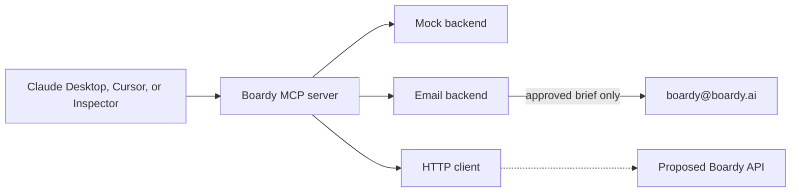

# Boardy MCP

An unofficial MCP server that lets an AI agent draft a Boardy intro, and demo the rest of the workflow on fixture data until Boardy has an API.

**Unofficial.** This project is not affiliated with, endorsed by, or maintained by [Boardy](https://www.boardy.ai). Boardy has not published a public REST API, SDK, or MCP server. The people in the mock backend are invented. `spec/openapi.yaml` is a proposal, not a spec Boardy ships.

Author: [Adam Pangelinan](https://github.com/adamtpang)

## Is this plug and play?

For a local demo, yes. `npx` is not available until this package is published, so today you clone the repo and point Claude Desktop or Cursor at `node dist/index.js`. The mock backend answers the tools with invented data.

For the thing people mean by a production MCP (open Claude or ChatGPT, sign in, and talk to your real Boardy account), no. Boardy still has to ship the API, run an authorization server, and host this process on HTTPS. The resource-server side of OAuth (protected resource metadata and a bearer check) is wired. This repo does not issue tokens. The checklist is [docs/FOR-BOARDY.md](docs/FOR-BOARDY.md).

## Why this is worth shipping

Boardy finds a specific person you need (a customer, an investor, a hire, a job, a partner, a supplier, an expert) and introduces you once you both agree. People already reach him by text, WhatsApp, X, or email, and from ChatGPT and Claude. The public guide for assistants is an email to `boardy@boardy.ai`: the assistant writes a brief, the user approves the exact text, and it goes out from the user's own mailbox.

That guide is a real agent channel. It cannot list your intros, tell you a match is waiting, or record an accept or a decline. The ChatGPT app can do some of that inside ChatGPT (accept a match, decline with a reason, see intros in progress, open a booked meeting). Coding agents are the same kind of front door, and they are where a lot of "who should I talk to?" questions already happen.

An MCP server is a small, shared tool surface for that. Today it can draft the brief the guide already specifies, and show the user the email before anything is sent. The day Boardy ships an API shaped like `spec/openapi.yaml`, the same tools can read intro status and respond, without anyone pasting text between a chat and an inbox. Double opt-in stays. The user still approves the exact email. Email and phone stay hidden until both people agree, which is the rule in [Boardy's FAQ](https://www.boardy.ai/faq).

Agents are a distribution channel Boardy has already started. A public MCP would make the next client (Claude Desktop, Cursor, or anything else that speaks MCP) a front door instead of a one-off prompt.

## 60-second quickstart

```bash
git clone https://github.com/adamtpang/boardymcp.git
cd boardymcp
npm install
npm test
npm run build
npm run smoke
```

`npm run smoke` starts the mock server three ways (in-process, stdio, and streamable HTTP), calls `tools/list`, and calls a tool. The default backend is mock. Nothing is emailed to Boardy.

Then open it in MCP Inspector:

```bash
npx @modelcontextprotocol/inspector node dist/index.js
```

In the browser tab, click Connect. Open Tools. Run `list_intros`, then `get_intro` with `introId` set to `fix_awaiting_you`. The result says it is fixture data.

To try the proposed HTTP API against the same fixtures:

```bash
node dist/index.js api
curl -s -H 'X-API-Key: fixture' http://127.0.0.1:8787/v1/intros | head
```

The only accepted credential on that local server is the literal string `fixture`.

## Configure Claude Desktop

`~/Library/Application Support/Claude/claude_desktop_config.json` on macOS, or `%APPDATA%\Claude\claude_desktop_config.json` on Windows:

```json
{
  "mcpServers": {
    "boardy": {
      "command": "node",
      "args": ["/absolute/path/to/boardymcp/dist/index.js"],
      "env": {
        "BOARDY_BACKEND": "mock"
      }
    }
  }
}
```

Restart Claude Desktop. Ask it to list your Boardy intros. It should say the data is fake.

After `npm publish` (not done yet; `boardy-mcp` was free on the npm registry when this was written), the same shape works without a checkout:

```json
{
  "mcpServers": {
    "boardy": {
      "command": "npx",
      "args": ["-y", "boardy-mcp"]
    }
  }
}
```

A hosted server, once Boardy has a public HTTPS URL, is a URL entry. Claude, Cursor, and ChatGPT custom connectors all use that shape. OAuth starts only if the server answers `401` with protected resource metadata, which `BOARDY_AUTH=oauth` does.

```json
{
  "mcpServers": {
    "boardy": {
      "url": "https://mcp.example.com/mcp"
    }
  }
}
```

`https://mcp.example.com` is a placeholder. This repo does not host a server there.

## Configure Cursor

`.cursor/mcp.json` in the project, or your global MCP config:

```json
{
  "mcpServers": {
    "boardy": {
      "command": "node",
      "args": ["/absolute/path/to/boardymcp/dist/index.js"],
      "env": {
        "BOARDY_BACKEND": "mock"
      }
    }
  }
}
```

Streamable HTTP, after `node dist/index.js http`:

```json
{
  "mcpServers": {
    "boardy": {
      "url": "http://127.0.0.1:3000/mcp"
    }
  }
}
```

The HTTP server binds to `127.0.0.1` and checks the Host and Origin headers, which is what the MCP TypeScript SDK recommends for a localhost server.

## Tools

| Tool | What it does |
| --- | --- |
| `get_backend_status` | Which backend is connected, and which operations it can really perform. |
| `get_my_brief` | Who the user is, how the work is going, and who they want to meet. |
| `update_what_im_looking_for` | Replace that search. On the email backend this only drafts an update. |
| `list_intros` | Introductions, filterable by the proposed status. |
| `get_intro` | One introduction. Email and phone are omitted until both people have agreed. |
| `request_intro` | Build the public brief. Returns the email and a `mailto:` link. Does not send unless you opt in. |
| `respond_to_intro` | Accept, decline with a reason, or propose times. |

Prompts: `draft-boardy-email`, `offer-boardy`, `respond-to-match`.

Resources: `boardy://status`, `boardy://profile`, `boardy://intros`, `boardy://intros/{id}`, `boardy://protocol`.

Proposed statuses, which are not a Boardy field list: `requested`, `awaiting_you`, `awaiting_them`, `in_progress`, `scheduled`, `declined`, `expired`, `completed`, `no_fit`.

## What is real, and what is mock

| | Mock (default) | Email protocol | Proposed HTTP |
| --- | --- | --- | --- |
| Data | Invented fixtures, labeled in every payload | Your local env vars only | Whatever `BOARDY_API_BASE_URL` returns. The local reference server is also fixtures. |
| List or get intros | Yes, fake | No. The public guide has no read API. | Client is ready. No live Boardy host. |
| Read a profile | Fake Mina Cho at Lumen Ledger | Local config, not a Boardy read | Client is ready. |
| Update what you're looking for | Updates the fixture | Drafts a short update email | `PATCH /v1/me/looking-for` |
| Request an intro | Stores a fake `requested` intro and still shows the email draft | Drafts the email to `boardy@boardy.ai`. Sends only with SMTP, `send: true`, and the exact body the user approved. | `POST /v1/intro-requests` |
| Accept, decline, propose times | Updates the fixture. A decline needs a reason. | Drafts a reply. It has no thread id, so it cannot file the reply for you. | `POST /v1/intros/{id}/responses` |

Checked 2026-11-09: [agents.md](https://www.boardy.ai/agents.md), [agentskill.md](https://www.boardy.ai/agentskill.md), [llms.txt](https://www.boardy.ai/llms.txt), the [FAQ](https://www.boardy.ai/faq), the [ChatGPT plugin help](https://www.boardy.ai/chatgpt-plugin/help), and the [APIs.io profile](https://apis.io/providers/boardy/) (0 APIs, no MCP server). This repo does not scrape boardy.ai, call undocumented hosts, or use session cookies.

### Email backend

```bash
BOARDY_BACKEND=email \
BOARDY_USER_NAME="Your Name" \
BOARDY_USER_EMAIL="you@example.com" \
BOARDY_USER_LINKEDIN="https://www.linkedin.com/in/your-profile" \
node dist/index.js
```

`request_intro` returns the draft and a mailto link. To send from this process you also set `BOARDY_SMTP_HOST`, `BOARDY_SMTP_PORT`, `BOARDY_SMTP_USER`, `BOARDY_SMTP_PASS`, and `BOARDY_SMTP_FROM`, and the tool call must set `send` to true, `userApprovedExactText` to true, and `approvedBody` to the exact drafted body. Anything else is refused. The From address has to be the user's own mailbox, because that is how Boardy recognizes the sender.

### HTTP backend, for the day an API exists

```bash
BOARDY_BACKEND=http \
BOARDY_API_BASE_URL="http://127.0.0.1:8787" \
BOARDY_API_KEY="fixture" \
node dist/index.js
```

Point `BOARDY_API_BASE_URL` at a real host only after Boardy publishes one. On stdio, a personal token in the environment stays on that machine. On HTTP, `BOARDY_AUTH=oauth` checks a bearer token and, when the backend is `http`, forwards that token to the API. The dev bearer below is a localhost shared secret, not a login.

```bash
BOARDY_AUTH=oauth \
BOARDY_OAUTH_ISSUER="https://auth.example.com" \
BOARDY_PUBLIC_URL="http://127.0.0.1:3000/mcp" \
BOARDY_DEV_BEARER="replace-me" \
node dist/index.js http
```

`BOARDY_OAUTH_ISSUER` must be an authorization server Boardy runs. This process will not invent its metadata. `BOARDY_DEV_BEARER` is accepted only when the request Host is localhost or `127.0.0.1`, unless `BOARDY_ALLOW_DEV_BEARER=1`. For a real token check, set `BOARDY_INTROSPECTION_URL` to an RFC 7662 endpoint. See [docs/FOR-BOARDY.md](docs/FOR-BOARDY.md).

## What the public guide changed in the design

A few rules from [agents.md](https://www.boardy.ai/agents.md) are enforced in code, not just described:

- The draft is addressed to `boardy@boardy.ai` and nothing else.
- The section headings match the brief Boardy asks assistants to write (who they are, where things stand with a month and year, how it's going, who they'd like to meet, what they can offer, notes, what to keep private, location, links).
- LinkedIn is required. The tool will not invent a profile URL.
- Empty sections are left out. Missing numbers stay missing.
- A first brief and a short update (when the user already talks to Boardy) are different emails.
- Nothing is sent until the user has approved that exact body.
- The mailto link is returned alongside the full text, because long links get cut off.

From [agentskill.md](https://www.boardy.ai/agentskill.md): the `offer-boardy` prompt offers once, names the kind of person, and then stays on the original task.

From the FAQ and the ChatGPT help page: both people have to agree, contact details wait for that, a decline needs a reason, and a match can expire or come back as no fit. The mock data includes those cases so a demo is not only the happy path. The FAQ also says there are daily caps and does not publish the numbers, so the proposal has a 429 and does not invent a quota.

## Architecture



The server is a thin MCP layer over one backend interface. Tools, resources, and prompts do not know whether the record is a fixture, a draft, or an HTTP response. They do say so in the text they return.

```text
src/mcp/server.ts        tools, resources, prompts
src/backend/mock.ts      seeded fixtures
src/backend/email.ts     agents.md drafts, optional SMTP
src/backend/http.ts      client for spec/openapi.yaml
src/reference-api.ts     local server that speaks that spec with fixtures
src/protocol/brief.ts    the email itself
src/auth/                resource-server OAuth gate, not an authorization server
```

## SDK

This uses the official MCP TypeScript SDK v2, `@modelcontextprotocol/server` and `@modelcontextprotocol/client`, which the [typescript-sdk](https://github.com/modelcontextprotocol/typescript-sdk) repo calls the stable line for the 2026-07-28 spec. npm lists `@modelcontextprotocol/server` at 2.4.0 and `@modelcontextprotocol/sdk` at 1.32.2. The v1 package is the maintenance line (spec through 2025-11-25), so this repo does not build on it.

That is not what every production server imports. GitHub's official server is Go and depends on `github.com/modelcontextprotocol/go-sdk` ([go.mod](https://github.com/github/github-mcp-server/blob/main/go.mod)). Sentry's MCP package lists both `@modelcontextprotocol/server` 2.4.0 and `@modelcontextprotocol/sdk` 1.32.2 in its [pnpm catalog](https://github.com/getsentry/sentry-mcp/blob/main/pnpm-workspace.yaml). Stripe, Linear, Notion, and Cloudflare document hosted HTTPS endpoints. Their server source is not the template this repo copies.

Stdio is `serveStdio`. Streamable HTTP is `createMcpHandler` plus `@modelcontextprotocol/node`. Bearer checks use the SDK's `requireBearerAuth`.

## Development

Requires Node 20 or newer. CI runs on Node 22.

```bash
npm run lint
npm run typecheck
npm test
npm run build
npm run smoke
```

Vitest covers the brief, the three backends, the reference API, and an in-process MCP client (`tools/list`, a tool call, a prompt list, a resource read). Smoke covers the built `dist/` output over stdio and HTTP.

## Roadmap

1. Keep the mock honest and the email draft faithful to the public guide. That is this repo.
2. If Boardy ships an API along these lines, set `BOARDY_BACKEND=http` and delete nothing else. The MCP server is already the client.
3. Host the HTTP server on a public HTTPS URL and point `BOARDY_OAUTH_ISSUER` at an authorization server Boardy operates (PKCE, and CIMD or DCR). The resource-server gate in this repo is the part that is already written.
4. Webhooks for a new match, after Boardy describes an event. Not before.
5. Leave inbox reading alone. If an assistant can already read the user's mail, the public guide tells it to point out messages from `boardy@boardy.ai`. That is the mail client, not this server.

## License

MIT. See [LICENSE](LICENSE).
